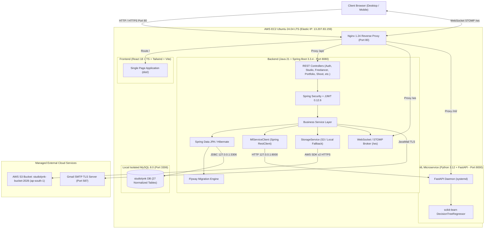
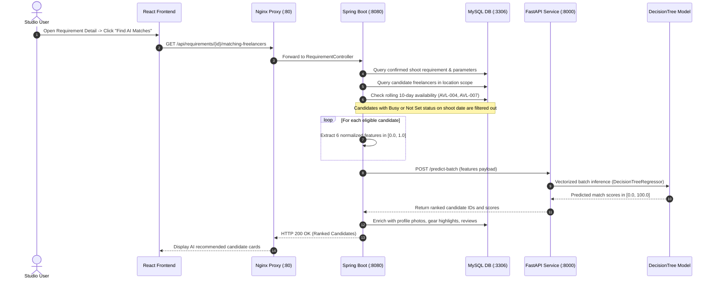
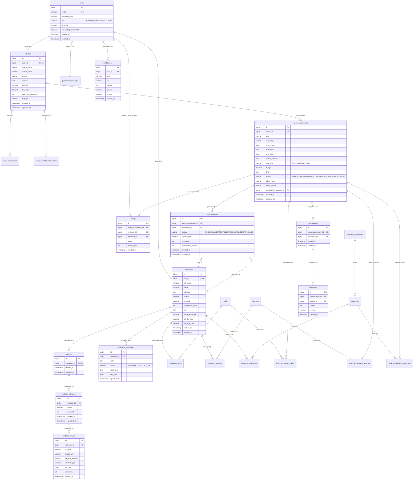

# StudioLynk Architecture and Entity-Relationship Specification

## 1. High-Level System Architecture

The StudioLynk platform is structured as a decoupled three-tier system reverse-proxied by Nginx on an AWS EC2 instance (Ubuntu 24.04 LTS), backed by MySQL 8.0, Amazon S3 for cloud object storage, and a Python FastAPI Machine Learning microservice.

---

## 2. Component Interaction & Core Workflows

### 2.1 AI Requirement Matching & Candidate Discovery Flow

---

## 3. Complete Entity-Relationship (ER) Schema

StudioLynk operates on **27 normalized relational tables** in MySQL 8.0, maintained with strict foreign key constraints, primary keys, audit timestamps, and indexing.

---

## 4. Key Architectural Safeguards & Design Decisions

1. **Private MySQL Isolation**: MySQL 8.0 listens strictly on loopback interface `127.0.0.1:3306`. It cannot be reached from the public internet.
2. **Reverse Proxying with Protocol Upgrade**: Nginx on Port 80 manages SPA routing with fallback to `/index.html`, and proxies WebSocket requests to `/ws` with HTTP `Upgrade` and `Connection` headers.
3. **Pluggable Storage Abstraction**: `StorageService` interface decouples controllers from physical storage. The system automatically binds `S3StorageServiceImpl` when AWS credentials and bucket parameters are configured, and gracefully falls back to `LocalStorageServiceImpl` for local/offline testing.
4. **Autonomous Onboarding**: Studio and Freelancer users gain immediate platform access upon completing onboarding without administrative verification bottlenecks.
5. **Client Privacy Protection**: Direct client names and phone numbers are encrypted/masked and never surfaced to competing freelancers or public feeds; they are exclusively revealed to the single confirmed creator upon studio confirmation.
