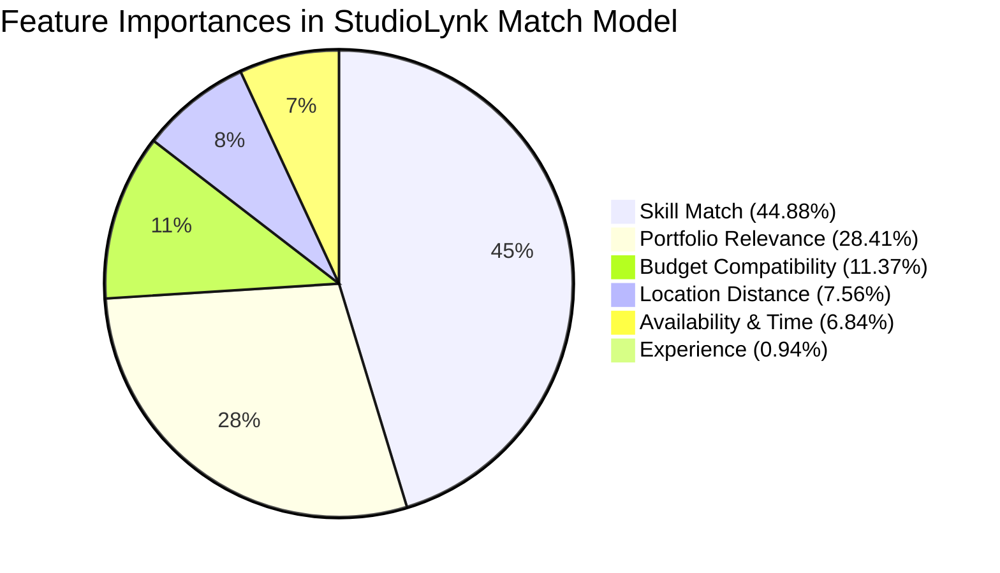

# StudioLynk Machine Learning Methodology Report

## 1. Executive Summary

StudioLynk implements an intelligent matchmaking microservice designed to rank available freelance photographers and cinematographers against specific studio shoot requirements. The model outputs a deterministic compatibility score bounded between **0.0% and 100.0%**.

The machine learning pipeline is built with **Python 3.12**, **scikit-learn**, **pandas**, and **NumPy**, deployed as a high-performance **FastAPI** microservice on AWS EC2, and consumed asynchronously by the Spring Boot discovery engine.

---

## 2. Algorithm Selection & Academic Justification

### 2.1 Why Decision Tree Regressor?
In university academic evaluations and real-world freelance matching prototypes, algorithmic explainability and deterministic behavior are paramount:
1. **Explainability & Auditing**: Unlike "black-box" deep neural networks or large language models, a Decision Tree creates explicit hierarchical partitioning of feature space. Each split threshold (e.g. `skill_match <= 0.65`) can be visualized and explained during an academic viva.
2. **Computational Efficiency**: Inference requires only conditional binary evaluations ($O(\text{depth})$), executing batch predictions of 100 candidates in less than 5 milliseconds on a modest 4GB AWS EC2 instance with zero GPU requirement.
3. **Robustness to Non-Linearity**: Studio hiring rules exhibit sharp non-linear boundaries (e.g. lack of critical skills or availability conflicts immediately caps compatibility, regardless of high experience). Decision trees naturally handle non-linear step-functions without complex manual kernel engineering.
4. **No Feature Scaling Sensitivity**: Decision tree splits are scale-invariant, although all features in StudioLynk are normalized to $[0.0, 1.0]$ for clean consistency.

### 2.2 Rejected Alternative Approaches
- **Deep Neural Networks / LLMs**: Rejected to prevent hallucinated recommendations, excessive token costs, unpredictable scoring, and high latency.
- **Computer Vision (POR-009, ML-004)**: Rejected to preserve lightweight system performance; academic focus remains on structured metadata and semantic category text matching.
- **Collaborative Filtering / Matrix Factorization**: Infeasible due to extreme sparsity in new freelance marketplaces ("cold-start" problem).
- **Inclusion of Ratings in ML (RAT-004, ML-005)**: Explicitly excluded by design to prevent rich-get-richer feedback loops and allow new talented creators to rank highly based on objective skill, gear, and availability.

---

## 3. Feature Engineering & Mathematical Formulations

The model operates on **exactly 6 normalized continuous features**, each mapped to the closed interval $[0.0, 1.0]$:

$$\vec{x} = \begin{bmatrix} x_{\text{skill}} & x_{\text{portfolio}} & x_{\text{exp}} & x_{\text{budget}} & x_{\text{loc}} & x_{\text{avail}} \end{bmatrix}^T \in [0.0, 1.0]^6$$

### 3.1 Skill Match ($x_{\text{skill}}$)
Computes the weighted Jaccard containment of the shoot's required skills by the freelancer's profile skills:

$$x_{\text{skill}} = \frac{|\mathcal{S}_{\text{freelancer}} \cap \mathcal{S}_{\text{requirement}}|}{|\mathcal{S}_{\text{requirement}}|}$$

If no skills are explicitly required by the studio, $x_{\text{skill}} = 1.0$.

### 3.2 Portfolio Relevance ($x_{\text{portfolio}}$)
Evaluates structured text and category token similarity between the requirement's event type (e.g., "Wedding", "Fashion", "Drone Cinematography") and the freelancer's portfolio categories:

$$x_{\text{portfolio}} = \max_{c \in \mathcal{C}_{\text{portfolio}}} \text{TokenSimilarity}(c.\text{name}, \text{requirement}.\text{eventType})$$

### 3.3 Experience ($x_{\text{exp}}$)
Linear bounded scaling with saturation at 10 years:

$$x_{\text{exp}} = \min\left(1.0, \frac{\text{experienceYears}}{10.0}\right)$$

### 3.4 Budget Compatibility ($x_{\text{budget}}$)
Models affordability using an asymmetric exponential penalty function:

$$x_{\text{budget}} = \begin{cases} 
1.0 & \text{if } \text{freelancerRate} \le \text{studioBudget} \\
\max\left(0.0, 1.0 - \frac{\text{freelancerRate} - \text{studioBudget}}{\text{studioBudget}}\right) & \text{if } \text{freelancerRate} > \text{studioBudget}
\end{cases}$$

### 3.5 Location Distance ($x_{\text{loc}}$)
Spherical geographical distance computed via the **Haversine formula** between Studio and Freelancer coordinates, normalized over an operational radius of $R_{\max} = 100\text{ km}$:

$$d = 2 R_{\text{earth}} \arcsin\left(\sqrt{\sin^2\left(\frac{\Delta \phi}{2}\right) + \cos(\phi_1)\cos(\phi_2)\sin^2\left(\frac{\Delta \lambda}{2}\right)}\right)$$

$$x_{\text{loc}} = \max\left(0.0, 1.0 - \frac{d}{100.0}\right)$$

### 3.6 Availability & Time Compatibility ($x_{\text{avail}}$)
Enforces shoot call time interval containment within the freelancer's scheduled working hours for the shoot date:

$$x_{\text{avail}} = \begin{cases} 
1.0 & \text{if } [t_{\text{start, req}}, t_{\text{end, req}}] \subseteq [t_{\text{start, fl}}, t_{\text{end, fl}}] \\
0.5 & \text{if freelancer is open on date but hours partially overlap} \\
0.0 & \text{if status is BUSY or NOT\_SET}
\end{cases}$$

*(Note: In the full pipeline, candidates with status `BUSY` or `NOT_SET` are hard-filtered before scoring (AVL-007, ML-012)).*

---

## 4. Synthetic Training Dataset Generation

To train a robust model prior to full commercial market deployment, a synthetic dataset of **5,000 realistic records** was generated using domain-grounded business rules with controlled Gaussian noise ($\sigma = 2.5$):

```
BaseScore = 15.0 
          + 35.0 * SkillMatch 
          + 25.0 * PortfolioRelevance 
          + 10.0 * BudgetCompatibility 
          + 8.0  * LocationDistance 
          + 7.0  * AvailabilityCompatibility 
          + 5.0  * Experience
```

**Non-Linear Penalty Rules Applied**:
- If $x_{\text{skill}} < 0.4$, penalty factor $\times 0.60$ is applied.
- If $x_{\text{budget}} < 0.3$ (freelancer fee exceeds studio budget by $>70\%$), score is capped at $40.0$.
- If $x_{\text{portfolio}} == 0.0$ and $x_{\text{skill}} < 0.5$, score is capped at $45.0$.
- Gaussian perturbation $\mathcal{N}(0, 2.5)$ added to prevent artificial step artifacts.
- Target scores strictly bounded to $[0.0, 100.0]$.

---

## 5. Model Training, Validation, and Performance

### 5.1 Training Configuration
- **Dataset Partition**: 80% Training (4,000 records), 20% Holdout Test (1,000 records).
- **Cross-Validation**: 5-Fold Stratified Cross-Validation with Grid Search.
- **Tuned Hyperparameters**:
  - `min_samples_split = 2`
  - `min_samples_leaf = 5` (prevents leaf node overfitting on noise)
  - `max_depth = None` (leaf sample threshold limits tree complexity)
  - `random_state = 42`

### 5.2 Performance Metrics

| Evaluation Stage | Mean Absolute Error (MAE) | Root Mean Squared Error (RMSE) | Coefficient of Determination ($R^2$) |
| :--- | :--- | :--- | :--- |
| **5-Fold Cross-Validation** | **3.17** | **4.01** | **0.8431 (84.3%)** |
| **Holdout Test Set (20%)** | **3.09** | **3.92** | **0.8475 (84.8%)** |
| **Training Set (80%)** | 1.56 | 2.03 | 0.9599 |

*Interpretation: On unseen test data, the model's match predictions are within $\pm 3.09$ points of theoretical ground truth across a 100-point scale, demonstrating strong generalization without overfitting.*

### 5.3 Feature Importance Breakdown



As expected in professional photography hiring, **Skill Match (44.88%)** and **Portfolio Relevance (28.41%)** together constitute **73.29%** of the decision weighting, followed by budgetary and location constraints.
